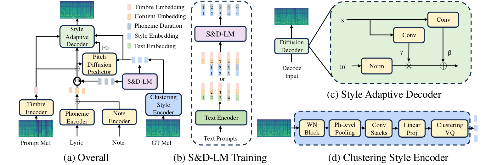

<h1>TCSinger: Zero-Shot Singing Voice Synthesis with Style Transfer and Multi-Level Style Control<br>
  <a href="https://2024.emnlp.org/"></a>
</h1>

<p>
  <strong><a href="https://aaronz345.github.io/">Yu&nbsp;Zhang</a></strong>, Ziyue&nbsp;Jiang, Ruiqi&nbsp;Li, Changhao&nbsp;Pan, Jinzheng&nbsp;He, Rongjie&nbsp;Huang, Chuxin&nbsp;Wang, Zhou&nbsp;Zhao&ensp;
</p>

<p>
  <a href="https://arxiv.org/abs/2409.15977"></a>
  <a href="https://aaronz345.github.io/TCSingerDemo/"></a>
  <a href="https://huggingface.co/AaronZ345/TCSinger"></a>
  <a href="https://zhuanlan.zhihu.com/p/777601485"></a>
</p>

##  Overview

TCSinger synthesizes singing from a target phoneme sequence and score, with styles from reference speech or singing and multi-level style controls. The implementation and pretrained checkpoints are available here.

Use [Quick start](#quick-start) with the released [checkpoints](#checkpoints) and the [input format](#input-format). See [style control](#style-control) for prompting options and the [training guide](docs/training.md) to train a model. To cite this work, use the [BibTeX entry](#citations).

##  News

- **2024.12** · Released TCSinger checkpoints.
- **2024.11** · Released TCSinger code.
- **2024.09** · Released the full [GTSinger](https://github.com/AaronZ345/GTSinger) dataset.
- **2024.09** · TCSinger was accepted to EMNLP 2024.

##  Quick start

| Released model | Requirements |
| --- | --- |
| Checkpoint languages | Chinese and English |
| Reference audio | 48 kHz speech or singing |
| Output | 48 kHz singing waveform |
| Runtime | Python 3.10, PyTorch 2.1.0 + CUDA 12.1 |

For other languages, train or fine-tune using [GTSinger](https://github.com/AaronZ345/GTSinger) or your own dataset. Style control is weaker for some timbres in the released checkpoint because its training includes speech and unannotated data; fine-tuning on annotated singing data is recommended.

Run from the repository root with an NVIDIA GPU, the checkpoints below, and prepared reference/target inputs.

### 1. Install the environment

```bash
git clone https://github.com/AaronZ345/TCSinger.git
cd TCSinger
conda create -n tcsinger python=3.10 -y
conda activate tcsinger
python -m pip install -r requirements.txt \
  --find-links https://download.pytorch.org/whl/torch_stable.html
```

The PyTorch wheel index supplies the pinned CUDA build. Set `CUDA_VISIBLE_DEVICES` to the existing device you intend to use.

### 2. Prepare checkpoints and data

Download `checkpoints/` from [Hugging Face](https://huggingface.co/AaronZ345/TCSinger/tree/main/checkpoints) into the repository root. Use [ZHEN_checkpoint_phone_set.json](ZHEN_checkpoint_phone_set.json) as `phone_set.json` in both `data/processed/tc/` and `data/binary/tc/` for the released checkpoint.

The default [style-transfer example](inference/style_transfer.py) reads `ref_name` and `gen_name` from `data/processed/tc/metadata.json`. Prepare GTSinger metadata and audio paths, then select entries that exist in your data. Alternatively, replace the example dictionary with the explicit fields in [Input format](#input-format). Check `processed_data_dir`, `binary_data_dir`, `fs2_ckpt_dir`, `decoder_ckpt_dir`, and `vocoder_ckpt` in the configuration files.

When using Chinese or English GTSinger metadata with this checkpoint, remove the language suffix `_zh` or `_en` from each phoneme. Match the supplied checkpoint vocabulary before inference.

### 3. Run style transfer

```bash
PYTHONPATH=. CUDA_VISIBLE_DEVICES=0 python inference/style_transfer.py \
  --config egs/sdlm.yaml --exp_name checkpoints/SDLM
```

The example writes `infer_out/transfer.wav`.

##  Checkpoints

| Component | Local path | Configuration |
| --- | --- | --- |
| TCSinger | `checkpoints/TCSinger/` | [egs/tcsinger.yaml](egs/tcsinger.yaml) |
| SAD | `checkpoints/SAD/` | [egs/sad.yaml](egs/sad.yaml) |
| SDLM | `checkpoints/SDLM/` | [egs/sdlm.yaml](egs/sdlm.yaml) |
| HIFI-GAN | `checkpoints/hifigan/` | Vocoder checkpoint and `config.yaml` |

[Hugging Face](https://huggingface.co/AaronZ345/TCSinger) · [Google Drive mirror](https://drive.google.com/drive/folders/1t57KKccSMGkrJhCRRCTo6XoXhCmZHFxl?usp=drive_link)

##  Input format

| Style-transfer field | Meaning |
| --- | --- |
| `text_gen` | Target phoneme sequence |
| `note_gen`, `note_dur_gen`, `note_type_gen` | Target notes, durations, and note types |
| `text_in` | Reference phoneme sequence |
| `note_in`, `note_dur_in`, `note_type_in` | Reference notes, durations, and note types |
| `ref_audio` | Path to the 48 kHz reference recording |
| `ph_durs` | Reference phoneme durations used for alignment |

Keep each phoneme/score sequence aligned. Note types are rest: 1, lyric: 2, and slur: 3. The source [example](inference/style_transfer.py) shows how these fields map from GTSinger metadata.

##  Style control

Edit the input dictionary in [inference/style_control.py](inference/style_control.py). Supply the target phonemes and score, reference audio, per-phoneme `tech` entries, and `singing_method`, `emotion`, `pace`, and `range_` controls. The included metadata-backed example must point to entries that exist in your dataset.

```bash
PYTHONPATH=. CUDA_VISIBLE_DEVICES=0 python inference/style_control.py \
  --config egs/sdlm.yaml --exp_name checkpoints/SDLM
```

The example writes `infer_out/control.wav`. Fine-tune on annotated singing before relying on control for timbres where the released checkpoint is less effective.

##  Method and training

TCSinger combines a clustering style encoder, the Style and Duration Language Model (S&D-LM), and a style-adaptive decoder. The [paper](https://aclanthology.org/2024.emnlp-main.117/) reports comparisons for zero-shot style transfer, multi-level style control, cross-lingual transfer, and speech-to-singing transfer.

The [training guide](docs/training.md) covers metadata and phoneme sets, split configuration, binarization, and training TCSinger, SAD, and SDLM in sequence.

<p align="center">
  
  <br>
  <sub><a href="https://arxiv.org/html/2409.15977v6#S3.F1">Figure 1</a>. TCSinger architecture, including style and duration prediction and style adaptation.</sub>
</p>

##  Acknowledgements

This implementation uses parts of the code from the following Github repos:
[NATSpeech](https://github.com/NATSpeech/NATSpeech),
[StyleSinger](https://github.com/AaronZ345/StyleSinger)
as described in our code.

##  Citations

If you find this code useful in your research, please cite our work:
```bib
@inproceedings{zhang2024tcsinger,
  title={TCSinger: Zero-Shot Singing Voice Synthesis with Style Transfer and Multi-Level Style Control},
  author={Zhang, Yu and Jiang, Ziyue and Li, Ruiqi and Pan, Changhao and He, Jinzheng and Huang, Rongjie and Wang, Chuxin and Zhao, Zhou},
  booktitle={EMNLP},
  year={2024}
}
```

##  Disclaimer

Any organization or individual is prohibited from using any technology mentioned in this paper to generate someone's singing without his/her consent, including but not limited to government leaders, political figures, and celebrities. If you do not comply with this item, you could be in violation of copyright laws.
